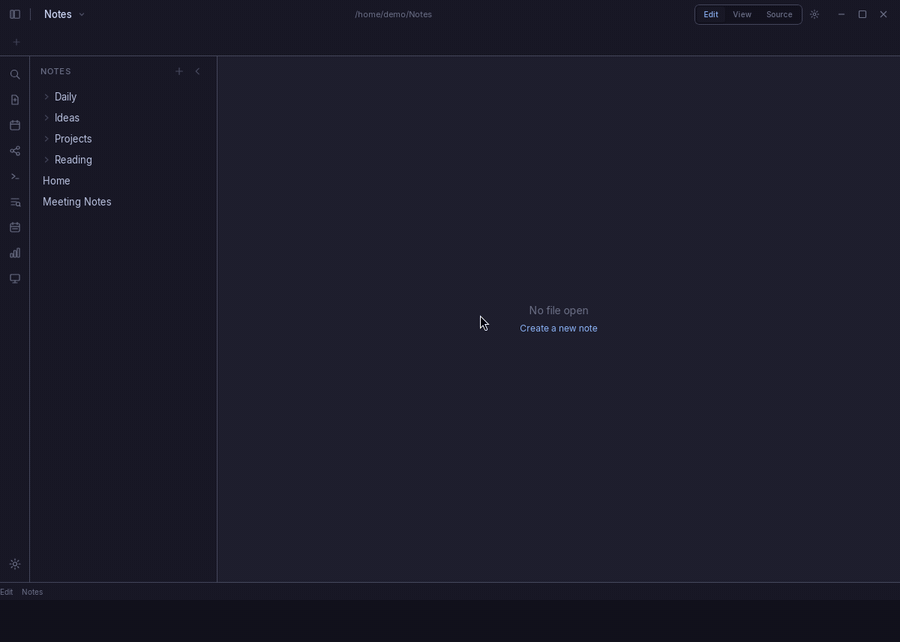

<div align="center">

<a href="https://www.noteriv.com">
  
</a>

<br />
<br />

<a href="https://github.com/thejacedev/Noteriv/releases/latest"></a>
<a href="https://github.com/thejacedev/Noteriv/releases"></a>
<a href="https://www.npmjs.com/package/noteriv-mcp"></a>
<a href="https://github.com/thejacedev/Noteriv/stargazers"></a>
<a href="LICENSE"></a>

<h3>
  <a href="https://www.noteriv.com">Website</a>
  <span>&nbsp;·&nbsp;</span>
  <a href="https://thejacedev.github.io/Noteriv/">Docs</a>
  <span>&nbsp;·&nbsp;</span>
  <a href="#-install">Download</a>
  <span>&nbsp;·&nbsp;</span>
  <a href="#-community">Plugins &amp; themes</a>
  <span>&nbsp;·&nbsp;</span>
  <a href="#-contributing">Contribute</a>
</h3>

<p>
  The open-source markdown editor with a graph view, plugin API, themes, Git/WebDAV sync
  and an MCP server for your AI, built on <b>Tauri 2</b>. About 15 MB, on Linux, macOS and Windows.
</p>



<sub>📱 The <a href="#-mobile">mobile app</a> is a work in progress. Every feature ships to desktop first.</sub>

</div>


## 💡 Why Noteriv?

Most note apps lock you into their cloud, their format, or their platform. Noteriv doesn't.

**Coming from Obsidian?** Open your existing vault folder as it is: no import, no conversion. Notes, folders, `[[wiki-links]]`, tags, frontmatter and callouts carry over, and Noteriv leaves your `.obsidian` folder alone. See [what carries over and what doesn't](https://thejacedev.github.io/Noteriv/getting-started/from-obsidian).

<table>
  <tr>
    <td width="25%" valign="top">
      <h3>📄</h3>
      <b>Plain markdown</b><br />
      <sub>No proprietary format. Your notes are <code>.md</code> files you can open in any editor, anywhere.</sub>
    </td>
    <td width="25%" valign="top">
      <h3>🔒</h3>
      <b>Your data stays yours</b><br />
      <sub>Notes live on your device. Sync with Git, WebDAV or a cloud folder if you want, or don't.</sub>
    </td>
    <td width="25%" valign="top">
      <h3>💻</h3>
      <b>Every platform</b><br />
      <sub>A native desktop app for Linux, macOS and Windows, plus a mobile app for Android and iOS.</sub>
    </td>
    <td width="25%" valign="top">
      <h3>🧩</h3>
      <b>Make it yours</b><br />
      <sub>Plugins, themes and CSS snippets, from the community or written yourself.</sub>
    </td>
  </tr>
</table>

## ✨ Features



<details>
<summary><b>✍️ Editor</b>: live preview, source and read modes, vim, focus mode, split view</summary>
<br />

- **Live markdown preview**: see rendered output as you type
- **Source mode**: raw markdown with syntax highlighting
- **Read-only mode**: a clean rendered view for reading
- **Formatting toolbar**: bold, italic, headings, links, lists, code, tables, horizontal rules
- **Auto-save**: configurable intervals (10s, 30s, 1m, 5m) or manual
- **Spell check**: toggle on or off
- **Vim mode**: optional vim keybindings (desktop)
- **Focus mode**: dims every line except the active one. <kbd>Ctrl</kbd>+<kbd>Shift</kbd>+<kbd>D</kbd>
- **Split editor**: two notes side by side. Right-click a tab → "Open in Split", or <kbd>Ctrl</kbd>+<kbd>\\</kbd>
- **Per-file view mode**: right-click in the editor to set a default mode (Live/Source/View) per file, kept across restarts
- **Multi-select sidebar**: <kbd>Ctrl</kbd>+click to toggle, <kbd>Shift</kbd>+click for a range. Merge, delete or move in bulk

</details>

<details>
<summary><b>📝 Markdown</b>: tables, math, Mermaid, callouts, footnotes and more</summary>
<br />

- Headings (H1–H6); bold, italic, strikethrough, highlight; superscript and subscript
- Ordered and unordered lists, task lists with checkboxes
- Tables with alignment, plus interactive checkboxes in cells
- Fenced code blocks with syntax highlighting
- Block and inline math (LaTeX via KaTeX)
- **Mermaid diagrams**: flowcharts, sequence diagrams, Gantt charts, pie charts and more, rendered inline from ` ```mermaid ` blocks
- Callouts / admonitions (16+ types)
- Footnotes and definition lists
- HTML blocks

</details>

<details>
<summary><b>🕸️ Linking &amp; organization</b>: wiki-links, backlinks, tags, graph, vaults</summary>
<br />

- **Wiki-links**: link notes with `[[note name]]`, with aliases `[[note|display]]` and headings `[[note#heading]]`
- **Backlinks panel**: every note that links to the current file
- **Tags**: hierarchical tags with `#tag` and `#parent/child`
- **Graph view**: interactive force-directed knowledge graph (desktop)
- **Hover preview**: preview linked notes on hover (desktop)
- **Vaults**: separate vaults for different projects or areas of life
- **Folders**: nested folders with drag-and-drop reordering
- **Bookmarks**: pin the notes you open most
- **Outline panel**: table of contents from headings
- **Quick open**: fuzzy file search across your vault
- **Vault search**: full-text search across all notes
- **Daily notes**: one click to today's note
- **Random note**: rediscover forgotten ideas

</details>

<details>
<summary><b>🛠️ Content tools</b>: templates, Dataview queries, flashcards, slides, PDF and HTML export</summary>
<br />

- **Templates**: create notes from templates with variables (`{{date}}`, `{{time}}`, `{{title}}` and more)
- **Frontmatter editor**: YAML metadata editing with property suggestions
- **Note composer**: merge several notes, or split one by heading level
- **Merge from the sidebar**: <kbd>Ctrl</kbd>+click several files → right-click → "Merge N Notes" to combine them with `---` separators
- **File recovery**: automatic snapshots (up to 50 per file) with one-click restore
- **Slide presentations**: present markdown as slides (split by `---`), with speaker notes
- **PDF export**: export notes to PDF (desktop)
- **Table of contents**: type `[TOC]` for a clickable table of contents. `<!-- toc -->` blocks update on save
- **Dataview queries**: query your vault like a database with `TABLE`, `LIST` and `TASK` queries in ` ```dataview ` blocks. Filter by tags, folders, frontmatter fields and more
- **Flashcard review**: SM-2 spaced repetition. Add `Q:`/`A:` pairs or `{{cloze}}` deletions to notes, then review with keyboard grading (Again/Hard/OK/Good/Easy). Progress is saved per vault

</details>

<details>
<summary><b>🎨 Media &amp; attachments</b>: canvas, drawing editor, PDF annotation, audio and video</summary>
<br />

- **Attachment manager**: browse, filter and manage every attachment in the vault
- **Images**: PNG, JPG, GIF, SVG, WebP and more
- **Audio**: MP3, WAV, OGG, FLAC, AAC
- **Video**: MP4, MKV, AVI, MOV
- **Audio recorder**: record voice notes in the app (desktop)
- **Canvas / whiteboard**: an infinite canvas with text nodes, sticky notes (6 colors), images, freehand drawing, file embeds, groups and edge connections
- **PDF annotation**: open PDFs inline with highlight (4 colors), underline and note tools. Annotations save to a sidecar JSON and export to linked markdown with blockquotes and page references
- **Drawing editor**: pencil, shapes, arrows, text and eraser, with a full color picker, stroke widths, and pan and zoom. Drawings are `.drawing` files you can embed with `![[file.drawing]]`

</details>

<details>
<summary><b>🔄 Sync</b>: GitHub, WebDAV, cloud folders, with a live vault watcher</summary>
<br />

- **GitHub sync**: push and pull notes to and from any GitHub repository
- **Auto-sync every 5 seconds**: always-on background sync, pull first then push, no config needed
- **Pull on open**: fetch the latest changes when a vault opens
- **Folder sync**: Google Drive, Dropbox, OneDrive, iCloud (desktop)
- **WebDAV sync**: Nextcloud, ownCloud or any WebDAV server (desktop)
- **Vault file watcher**: picks up outside changes (the MCP server, git pulls, other editors). The sidebar refreshes on its own, open files without unsaved changes reload instantly, and open files with unsaved changes are saved first

</details>

<details>
<summary><b>🗂️ Views</b>: Kanban boards and a calendar</summary>
<br />

**Board view.** Turn any note into a drag-and-drop task board: create a `.board.md` file or add `board: true` to frontmatter. H2 headings are columns and checkbox items are cards.

- Drag cards between columns, double-click to edit inline
- Tags as colored pills, due date badges
- Auto-saves every 5 seconds; switch to Source mode for the raw markdown

**Calendar view.** A month calendar of your daily notes and tasks with due dates.

- Blue dots for daily notes, green dots for due tasks
- Click a day to see its notes and tasks, double-click to open or create its daily note
- Month navigation and a "Today" button, from the ribbon or the command palette

</details>

<details>
<summary><b>🤝 Collaboration &amp; sharing</b>: live co-editing, publish as HTML, web clipper</summary>
<br />

**Live collaboration.** Real-time co-editing with Yjs CRDTs over WebRTC: peer-to-peer, no server.

- Start a session and share the room ID; others join from the command palette
- Changes sync instantly between peers, with a custom display name and cursor color
- Optional dependency: `npm install yjs y-webrtc`

**Publish as HTML.** Export notes as standalone web pages in your current theme.

- Live preview before saving, or edit the raw HTML directly
- Search your vault and combine several notes into one page
- Copy the HTML, or save it as `.html` and open it in your browser

**Web clipper.** A browser extension that saves articles and selections into your vault as markdown.

- Clip a full page or just the selection, from the popup or the right-click menu
- Pure-JS HTML-to-markdown (headings, links, images, lists, code, tables)
- Set the title, tags and folder; frontmatter gets the title, source URL, date and tags
- Talks to a localhost API on port 27123 that starts with the app, and the sidebar refreshes as soon as a note lands
- Install: load `extension/` as an unpacked extension in Chrome, Brave or Edge, or as a temporary add-on in Firefox

</details>

<details>
<summary><b>🎛️ Customization</b>: 10 themes, 8 accent colors, plugins, CSS snippets, editor settings</summary>
<br />

**Themes.** 10 built-in themes, dark and light:

| | |
|---|---|
| **Dark** | Catppuccin Mocha, Nord, Dracula, Solarized Dark, One Dark, Gruvbox Dark, Tokyo Night, GitHub Dark |
| **Light** | Catppuccin Latte, Solarized Light |

Plus community themes from [NoterivThemes](https://github.com/thejacedev/NoterivThemes), custom themes with import/export (desktop), and 8 accent colors: Blue, Lavender, Mauve, Pink, Peach, Yellow, Green, Teal.

**Plugins and snippets.** Install community [plugins](https://github.com/thejacedev/NoterivPlugins) and [CSS snippets](https://github.com/thejacedev/NoterivSnippets), and enable or disable each one per vault.

**Editor settings**

| Setting | Options |
|---|---|
| Auto-save interval | Off, 10s, 30s, 1 min, 5 min (sync runs every 5s regardless) |
| Font size | 12px – 24px |
| Line height | 1.2 – 2.0 |
| Tab size | 2, 4, 8 |
| Editor font | JetBrains Mono, Fira Code, Cascadia Code, Source Code Pro, SF Mono, System Mono |
| Theme | 10 built-in + community + custom |
| Accent color | 8 options |
| Spell check | On / Off |

</details>

## 🤖 AI integration

Noteriv ships an [MCP server](mcp/) that gives Claude, Cursor or any other MCP client full read/write access to your vault.

```bash
claude mcp add --scope user noteriv -- npx -y noteriv-mcp
```

Or run `npx noteriv-mcp` yourself. It finds your active vault from the Noteriv config, so there's no path to set up.

- **22 tools**: read, write, append, delete and rename notes; list, create and delete folders; full-text search; tags, backlinks and outgoing links; vault stats; daily notes
- **Multi-vault**: switch vaults, or pass a path as a CLI argument
- **Live sync**: the desktop app watches the vault and refreshes the sidebar and open files whenever the MCP server changes something
- **Soft delete**: deleted notes go to `.noteriv/trash/` and can be restored from the app
- **MCP resources**: notes are also exposed as `note:///` resources

## 📦 Install

<div align="center">

<a href="https://github.com/thejacedev/Noteriv/releases/latest"></a>
<a href="https://github.com/thejacedev/Noteriv/releases/latest"></a>
<a href="https://github.com/thejacedev/Noteriv/releases/latest"></a>
<br />
<a href="https://apps.apple.com/app/id6761115699"></a>
<a href="https://play.google.com/store/apps/details?id=com.ironstacksoftware.noteriv"></a>
<a href="app-apk/noteriv.apk"></a>

</div>

### 🖥️ Desktop

> **Tauri 2 + Next.js**: Windows, macOS, Linux. A CodeMirror editor, native file system access, and Git through your system's git binary.

**Fedora (COPR)**: `dnf upgrade` keeps it current.

```bash
sudo dnf copr enable jacedev/noteriv
sudo dnf install noteriv
```

**Flatpak (any distro)**: `flatpak update` keeps it current.

```bash
flatpak remote-add --if-not-exists --no-gpg-verify noteriv https://flatpak.thejacedev.xyz/noteriv/repo
flatpak install noteriv com.noteriv.Noteriv
```

**macOS (Homebrew)**: `brew upgrade --cask noteriv` keeps it current.

```bash
brew install --cask thejacedev/tap/noteriv
```

**Windows (Scoop)**: the portable build. `scoop update noteriv` keeps it current.

```powershell
scoop bucket add thejacedev https://github.com/thejacedev/scoop-bucket
scoop install noteriv
```

**Everything else**: grab a build from the [latest release](https://github.com/thejacedev/Noteriv/releases/latest).

| Platform | Formats |
|---|---|
| Linux | `.rpm`, `.deb`, AppImage |
| Windows | `.exe` installer, `.msi`, portable `.zip` |
| macOS | `.dmg` (universal) |

### 📱 Mobile

> **Expo + React Native**: Android, iOS. **Work in progress**: features land on desktop first, then mobile.

The mobile app aims for parity with desktop, adapted for touch. Notes live in the app's document directory and sync through the GitHub REST API. Get it on the [App Store](https://apps.apple.com/app/id6761115699) or [Google Play](https://play.google.com/store/apps/details?id=com.ironstacksoftware.noteriv), or sideload the [APK](app-apk/noteriv.apk).

<details>
<summary><b>Mobile vs desktop</b></summary>
<br />

| Feature | Desktop | Mobile |
|---|---|---|
| Editor | CodeMirror 6 | TextInput + toolbar |
| Git sync | Native git binary | GitHub REST API + fresh clone |
| File storage | Any filesystem path | App document directory |
| Themes | 10 built-in + custom creator | 10 built-in + community install |
| Plugins | Sandbox execution | Install + enable/disable |
| Navigation | Sidebar + tabs + split editor | Stack navigation + swipe between notes |
| Graph view | Force-directed canvas | Force-directed WebView canvas |
| Board view | Drag-drop columns | Horizontal scroll columns with move actions |
| Calendar | Monthly grid | Monthly grid with daily note dots |
| Flashcards | SM-2 spaced repetition | SM-2 spaced repetition |
| Canvas | SVG whiteboard | — |
| Vim mode | CodeMirror vim extension | — |
| Audio recorder | MediaRecorder API | — |
| Drawing editor | Canvas with tools | — |
| PDF viewer | Inline annotations | — |
| Keyboard shortcuts | 70+ rebindable | System defaults |

</details>


## 🌐 Community

A growing set of community extensions, all installable from inside the app.

<table>
  <tr>
    <td align="center" width="33%" valign="top">
      <h3>🧩 Plugins</h3>
      <a href="https://github.com/thejacedev/NoterivPlugins"><b>thejacedev/NoterivPlugins</b></a>
      <p>Custom commands, sidebar panels, status bar items and editor integrations.</p>
      <sub><b>API:</b> vault read/write, UI commands, events (file-open, file-save, editor-change…), editor insert/replace/cursor</sub>
    </td>
    <td align="center" width="33%" valign="top">
      <h3>🎨 Themes</h3>
      <a href="https://github.com/thejacedev/NoterivThemes"><b>thejacedev/NoterivThemes</b></a>
      <p>Color themes beyond the 10 built-ins, covering backgrounds, text, accent and syntax colors.</p>
      <sub><b>Format:</b> JSON with an id, name, type (dark/light) and 16 colors. Import/export on desktop</sub>
    </td>
    <td align="center" width="33%" valign="top">
      <h3>✂️ CSS Snippets</h3>
      <a href="https://github.com/thejacedev/NoterivSnippets"><b>thejacedev/NoterivSnippets</b></a>
      <p>Fine-tune the editor and preview with CSS, toggled one snippet at a time.</p>
      <sub><b>Storage:</b> <code>.noteriv/snippets/</code>, one <code>.css</code> per snippet plus a config JSON</sub>
    </td>
  </tr>
</table>

<details>
<summary><b>Write a plugin</b></summary>
<br />

Plugins live in `.noteriv/plugins/{plugin-id}/` inside your vault:

```
my-plugin/
├── manifest.json    Plugin metadata
└── main.js          Entry point
```

**manifest.json**

```json
{
  "id": "my-plugin",
  "name": "My Plugin",
  "version": "1.0.0",
  "description": "What this plugin does",
  "author": "Your Name",
  "main": "main.js"
}
```

**main.js**

```javascript
module.exports = {
  onLoad(api) {
    api.ui.addCommand({
      id: "hello",
      name: "Say Hello",
      callback: () => api.ui.showNotice("Hello from my plugin!")
    });
  },
  onUnload() {
    // cleanup
  }
};
```

</details>

<details>
<summary><b>Make a theme</b></summary>
<br />

Themes are JSON files with 16 color properties:

```json
{
  "id": "my-theme",
  "name": "My Theme",
  "type": "dark",
  "colors": {
    "bgPrimary": "#1a1b26",
    "bgSecondary": "#16161e",
    "bgTertiary": "#24283b",
    "border": "#3b4261",
    "textPrimary": "#c0caf5",
    "textSecondary": "#a9b1d6",
    "textMuted": "#565f89",
    "accent": "#7aa2f7",
    "green": "#9ece6a",
    "red": "#f7768e",
    "yellow": "#e0af68",
    "blue": "#7aa2f7",
    "mauve": "#bb9af7",
    "peach": "#ff9e64",
    "teal": "#73daca",
    "pink": "#bb9af7"
  }
}
```

Save it to `.noteriv/themes/my-theme.json`, or open a PR on [NoterivThemes](https://github.com/thejacedev/NoterivThemes).

</details>

## 🔧 Development

You'll need [Node.js](https://nodejs.org/) 20.19+, npm, and [Git](https://git-scm.com/) (for the sync features).

```bash
git clone https://github.com/thejacedev/Noteriv.git
cd Noteriv/desktop
npm install
npm run dev     # Next.js on port 3456 + the Tauri window
```

`npm run build` writes distributables to `desktop/dist/`: AppImage, `.deb` and `.rpm` on Linux, `.dmg` on macOS, and an NSIS `.exe` on Windows.

| Command | Description |
|---|---|
| `cd desktop && npm run dev` | Desktop dev mode (Next.js + Tauri) |
| `cd desktop && npm run build` | Build desktop distributables |
| `cd desktop && npm run build:next` | Build Next.js only |
| `cd mcp && npm install` | Install MCP server dependencies |
| `node mcp/index.js` | Run the MCP server (vault path optional) |
| `cd phone && npx expo start` | Mobile dev server |
| `cd phone && npx expo start --android` | Run on Android |
| `cd phone && npx expo start --ios` | Run on iOS |
| `cd phone && npx expo export` | Export the mobile bundle |

<details>
<summary><b>Tech stack</b></summary>
<br />

| Layer | Desktop | Mobile |
|---|---|---|
| Framework | Next.js 16 | Expo 54 |
| UI | React 19 | React Native 0.81 |
| Editor | CodeMirror 6 | TextInput + custom renderer |
| Runtime | Tauri 2 (Rust) | Expo Router 6 |
| File I/O | Rust std::fs | expo-file-system |
| Sync | std::process git | GitHub REST API |
| Storage | JSON files | AsyncStorage |
| Styling | Tailwind CSS 4 | StyleSheet + dynamic themes |
| Math | KaTeX | — |
| Diagrams | Mermaid | — |

</details>

<details>
<summary><b>Project structure</b></summary>
<br />

```
Noteriv/
├── desktop/              Tauri 2 + Next.js desktop application
│   ├── src-tauri/        Rust backend (IPC, file I/O, Git, sync, clipper server, vault watcher)
│   ├── src/components/   41 React components + markdown rendering engine
│   ├── src/lib/          33 utility modules
│   └── public/           Platform icons + pdf.js worker
├── mcp/                  MCP server for AI assistant integration (22 tools, auto-discovers vaults)
├── extension/            Web Clipper browser extension (Manifest V3)
├── phone/                Expo + React Native mobile application
│   ├── app/              19 screens (Expo Router)
│   ├── components/       11 UI components
│   ├── lib/              24 utility modules
│   └── context/          App state + theme contexts
├── .github/workflows/    CI/CD (build + release)
├── LICENSE               MIT License
└── README.md
```

</details>

<details>
<summary><b>Desktop architecture</b></summary>
<br />

```
desktop/
├── src-tauri/             Rust backend (Tauri 2)
│   ├── src/
│   │   ├── lib.rs           App entry, plugin registration, startup
│   │   ├── shim.rs          window.electronAPI shim + drag/resize polyfill
│   │   ├── store.rs         Persistent config (vaults, settings)
│   │   ├── auth.rs          GitHub token storage + API
│   │   ├── updater_cmds.rs  Auto-update via tauri-plugin-updater
│   │   ├── clipper.rs       Web clipper local HTTP server
│   │   ├── watcher.rs       Vault file watcher (debounced)
│   │   ├── menu.rs          Hidden menu for keyboard accelerators
│   │   ├── commands_git.rs  Git operations via std::process::Command
│   │   ├── commands_sync.rs Folder + WebDAV sync providers
│   │   └── commands_*.rs    Other IPC commands
│   ├── Cargo.toml
│   ├── tauri.conf.json
│   └── capabilities/
├── package.json           # renderer deps + tauri scripts
├── src/
│   ├── app/
│   │   ├── page.tsx      Main app (90+ state variables)
│   │   ├── layout.tsx    Next.js root layout
│   │   └── globals.css   Global styles + CSS variables
│   ├── components/       41 React components
│   │   ├── Editor.tsx           CodeMirror markdown editor
│   │   ├── Sidebar.tsx          File tree with drag-drop
│   │   ├── TitleBar.tsx         Tabs + window controls
│   │   ├── SettingsModal.tsx    6-section settings
│   │   ├── SetupWizard.tsx      First-run wizard
│   │   ├── GraphView.tsx        Force-directed knowledge graph
│   │   ├── Canvas.tsx           Visual whiteboard
│   │   ├── SlidePresentation.tsx  Markdown presentations
│   │   ├── CommandPalette.tsx   Searchable action palette
│   │   ├── ThemePicker.tsx      Theme browser + installer
│   │   ├── PluginManager.tsx    Plugin browser + installer
│   │   ├── CSSSnippets.tsx      Snippet editor + community
│   │   ├── DrawingEditor.tsx    Canvas drawing editor (pencil, shapes, arrows, text, eraser)
│   │   ├── CalendarView.tsx     Month calendar with daily notes + tasks
│   │   ├── BoardView.tsx        Drag-and-drop task board
│   │   ├── DataviewBlock.tsx    Vault query result renderer
│   │   ├── PublishPreview.tsx   HTML export preview + multi-note publish
│   │   ├── FlashcardReview.tsx  Spaced repetition flashcard review
│   │   ├── CollabPanel.tsx      Live collaboration session manager
│   │   ├── PDFViewer.tsx        PDF viewer with annotation tools
│   │   └── markdown/            Live rendering engine
│   │       ├── plugin.ts        CodeMirror ViewPlugin
│   │       ├── registry.ts      Renderer registration
│   │       ├── renderers/       15 block + inline renderers
│   │       ├── callouts.ts      Obsidian-style admonitions
│   │       ├── embeds.ts        Note embedding (![[file]])
│   │       ├── math.ts          KaTeX rendering
│   │       ├── mermaid.ts       Diagram rendering
│   │       ├── wikilinks.ts     Interactive wiki-links
│   │       └── slash-commands.ts  / command menu
│   ├── lib/              33 utility modules
│   │   ├── settings.ts          App settings + defaults
│   │   ├── theme-utils.ts       10 built-in themes + community
│   │   ├── plugin-api.ts        Plugin sandbox + API
│   │   ├── css-snippets.ts      CSS snippet system
│   │   ├── hotkeys.ts           70+ rebindable shortcuts
│   │   ├── editor-commands.ts   Formatting commands
│   │   ├── wiki-link-utils.ts   Link parsing + resolution
│   │   ├── tag-utils.ts         Tag extraction + aggregation
│   │   ├── frontmatter-utils.ts YAML frontmatter
│   │   ├── template-utils.ts    Template variables
│   │   ├── file-recovery.ts     Snapshot system
│   │   ├── note-composer-utils.ts  Merge + split
│   │   ├── attachment-utils.ts  Media management
│   │   ├── audio-utils.ts       Recording utilities
│   │   ├── canvas-utils.ts      Canvas data model
│   │   ├── slide-utils.ts       Presentation parser
│   │   ├── pdf-export.ts        PDF export
│   │   ├── sync-providers.ts    Folder + WebDAV config
│   │   ├── vim-mode.ts          Vim keybindings
│   │   ├── drawing-utils.ts     Drawing file create/parse/serialize/export
│   │   ├── calendar-utils.ts    Calendar grid, daily note mapping, task extraction
│   │   ├── board-utils.ts       Board parse/serialize, card/column CRUD
│   │   ├── dataview.ts          Vault query engine (TABLE, LIST, TASK)
│   │   ├── toc-utils.ts         Table of contents generation + auto-update
│   │   ├── publish.ts           HTML export with theme colors
│   │   ├── flashcard-utils.ts   SM-2 spaced repetition + card extraction
│   │   ├── collab.ts            Yjs CRDT + WebRTC collaboration
│   │   ├── focus-mode.ts        Focus/typewriter mode extension
│   │   └── pdf-annotation.ts   PDF annotation types + sidecar I/O + markdown export
│   └── types/
│       └── electron.d.ts  IPC type definitions (50+ methods)
└── public/               App icons (macOS, Windows, Linux)
```

</details>

<details>
<summary><b>Mobile architecture</b></summary>
<br />

```
phone/
├── app/                  Screens (Expo Router, file-based routing)
│   ├── _layout.tsx       Root layout + theme provider
│   ├── index.tsx          Home (notes list, daily note, random note)
│   ├── editor.tsx         Markdown editor + preview
│   ├── settings.tsx       Settings (themes, GitHub, ecosystem)
│   ├── setup.tsx          First-run wizard with GitHub auth
│   ├── templates.tsx      Template picker
│   ├── recovery.tsx       File recovery / snapshots
│   ├── composer.tsx       Note merge + split
│   ├── attachments.tsx    Attachment manager
│   ├── backlinks.tsx      Backlinks viewer
│   ├── frontmatter.tsx    YAML frontmatter editor
│   ├── slides.tsx         Slide presentation viewer
│   ├── snippets.tsx       CSS snippets (installed + community)
│   ├── plugins.tsx        Plugin manager (installed + community)
│   ├── calendar.tsx       Monthly calendar with daily note dots + due tasks
│   ├── flashcards.tsx     SM-2 spaced repetition flashcard review
│   ├── graph.tsx          Force-directed wiki-link graph (WebView canvas)
│   ├── trash.tsx          Trash / soft delete with restore
│   └── publish.tsx        Publish note as HTML + share sheet
├── components/
│   ├── MarkdownEditor.tsx   TextInput editor + formatting toolbar
│   ├── MarkdownPreview.tsx  Custom markdown renderer
│   ├── NotesList.tsx        File/folder browser
│   ├── SearchModal.tsx      Quick open + vault search
│   ├── CreateModal.tsx      Create file/folder
│   ├── VaultSwitcher.tsx    Switch/create vaults
│   ├── OutlinePanel.tsx     Document outline
│   ├── BookmarksPanel.tsx   Bookmarked files
│   ├── TagsPanel.tsx        Hierarchical tag browser
│   └── BoardView.tsx        Board view with columns + cards
├── context/
│   ├── AppContext.tsx       Global state (vault, settings, files, auto-sync)
│   └── ThemeContext.tsx     Dynamic theme provider
├── lib/
│   ├── file-system.ts       expo-file-system class API wrapper
│   ├── vault.ts             Vault CRUD + workspace
│   ├── settings.ts          Settings with defaults
│   ├── storage.ts           AsyncStorage wrappers
│   ├── github-sync.ts       GitHub REST API sync (push/pull)
│   ├── templates.ts         Template listing + variables
│   ├── frontmatter.ts       YAML parse/serialize
│   ├── file-recovery.ts     Snapshot system
│   ├── note-composer.ts     Merge + split
│   ├── wiki-links.ts        Link parsing + backlinks
│   ├── attachments.ts       Attachment management
│   ├── slide-utils.ts       Slide parser
│   ├── daily-note.ts        Daily note helper
│   ├── random-note.ts       Random note picker
│   ├── css-snippets.ts      CSS snippet system
│   ├── plugins.ts           Plugin management
│   ├── community.ts         Community theme support
│   ├── calendar-utils.ts    Month grid, task extraction
│   ├── flashcard-utils.ts   SM-2 algorithm, card extraction
│   ├── markdown-lint.ts     Linting rules (wiki-links, headings, code blocks)
│   ├── note-history.ts      Line-based diff (LCS algorithm)
│   ├── publish.ts           Markdown-to-HTML converter
│   ├── board-utils.ts       Board parse/serialize, card CRUD
│   └── dataview.ts          Vault query engine
├── constants/
│   └── theme.ts             10 built-in themes + accent colors
└── types/
    └── index.ts             TypeScript interfaces
```

</details>

## 🤝 Contributing

Contributions are welcome:

1. **Report bugs**: open an issue with steps to reproduce
2. **Suggest features**: open an issue describing what you'd like to see
3. **Submit code**: fork, branch, make your changes and open a PR
4. **Build plugins, themes or snippets**: share them via [NoterivPlugins](https://github.com/thejacedev/NoterivPlugins), [NoterivThemes](https://github.com/thejacedev/NoterivThemes) or [NoterivSnippets](https://github.com/thejacedev/NoterivSnippets)


<div align="center">
  <sub><a href="LICENSE">MIT</a> © Jace Sleeman · Built with care by <a href="https://github.com/thejacedev">@thejacedev</a></sub>
</div>
